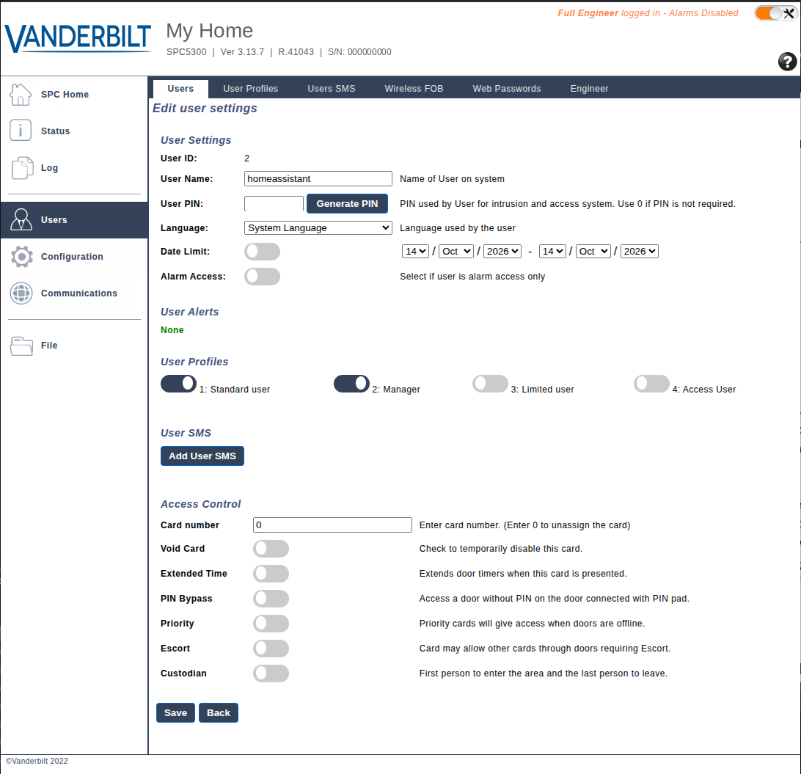
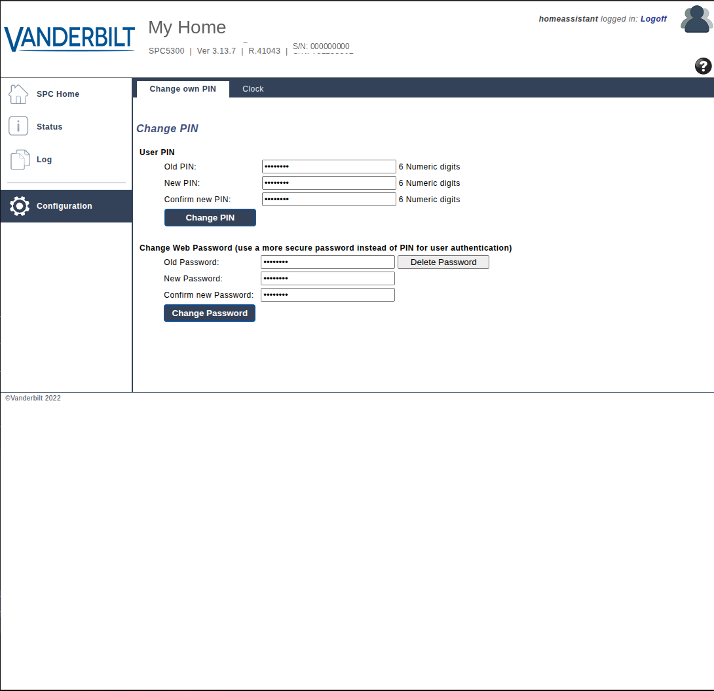
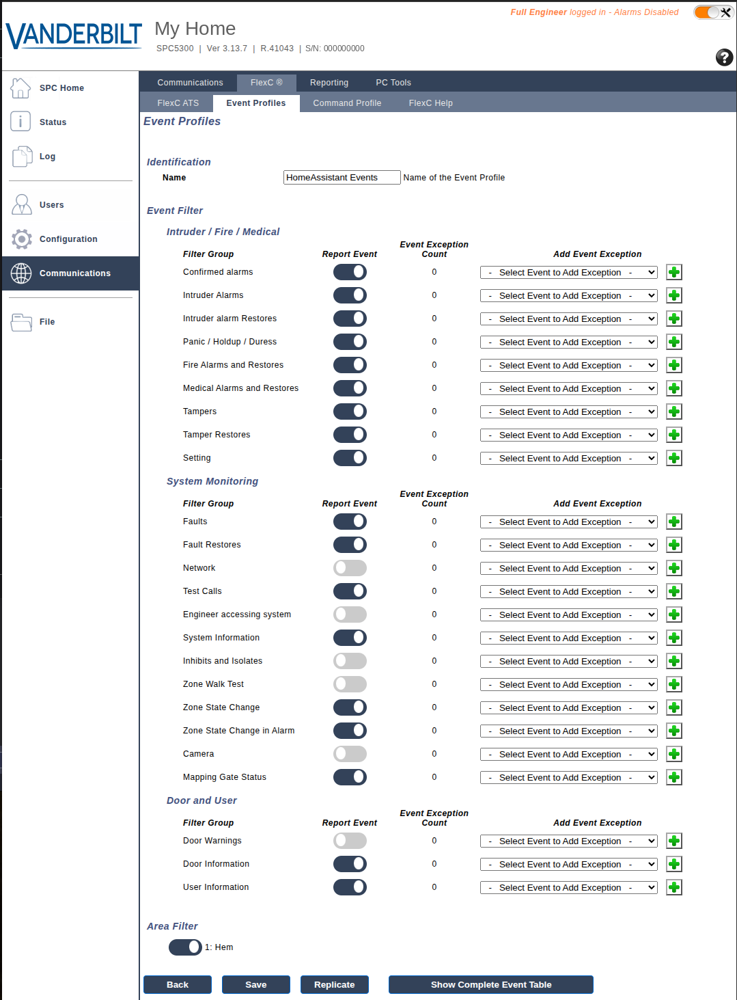
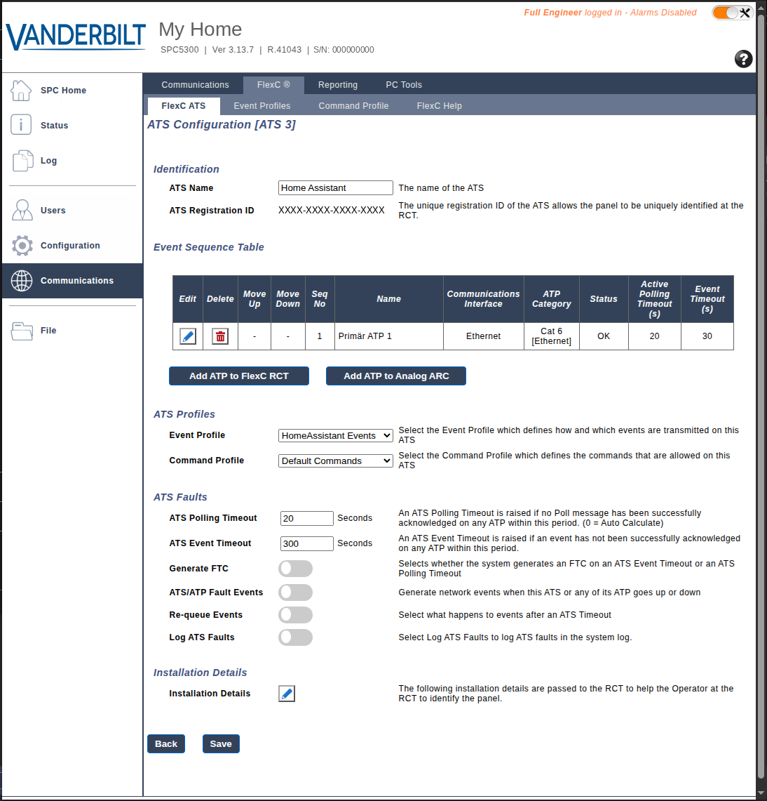
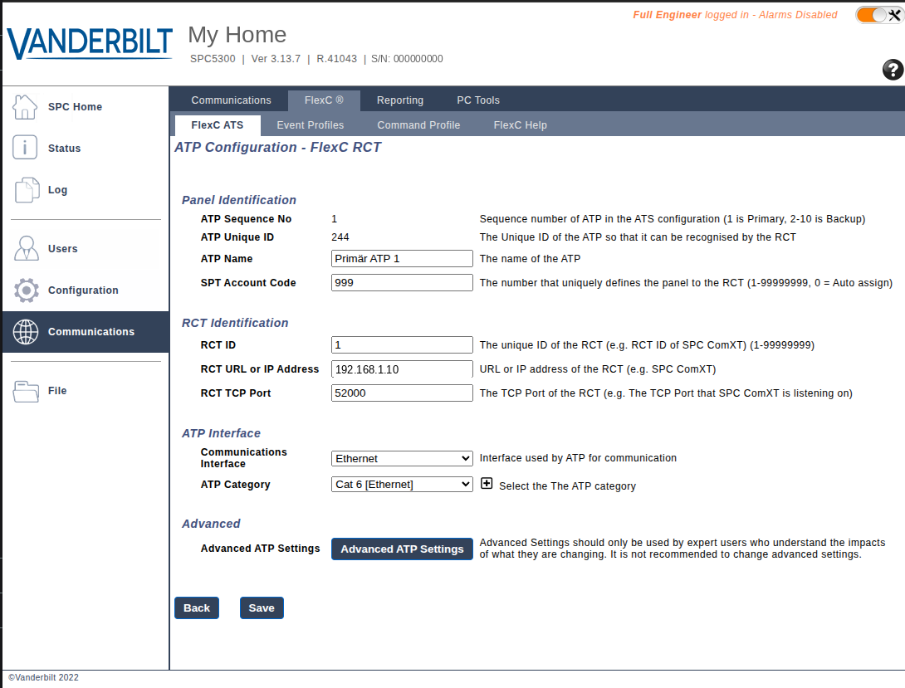
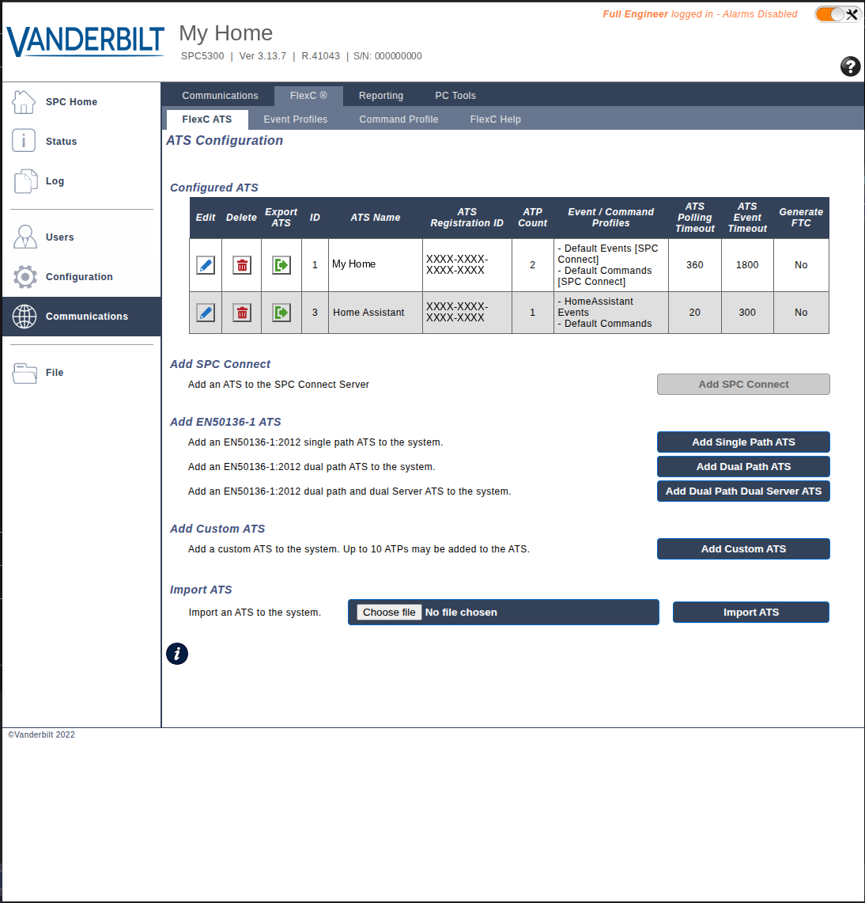
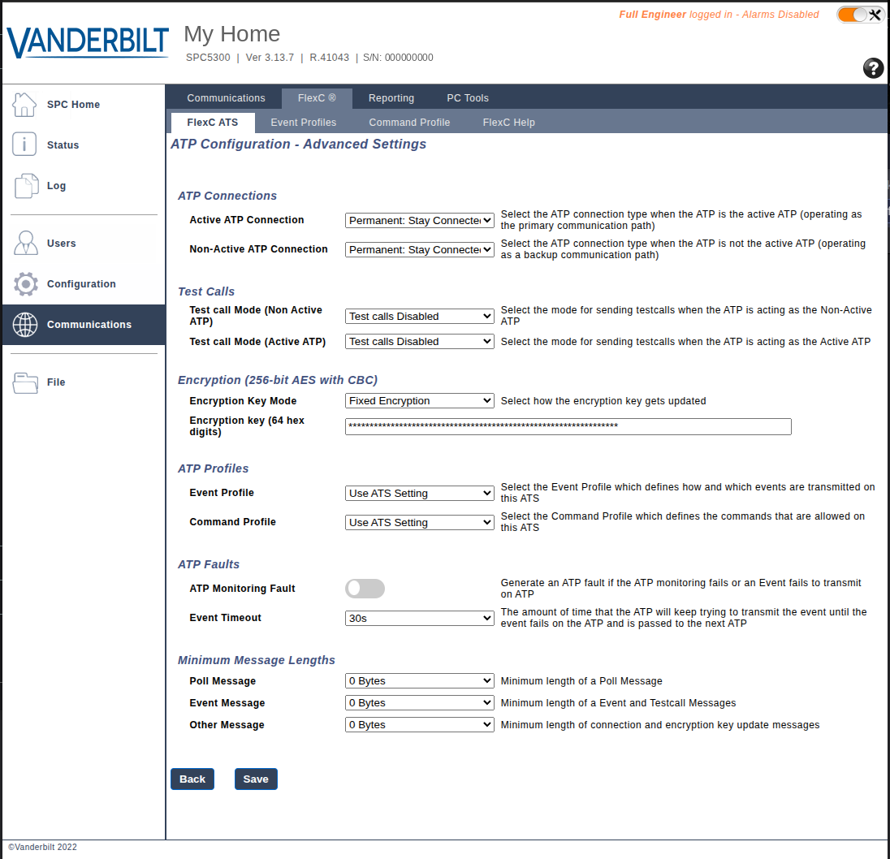
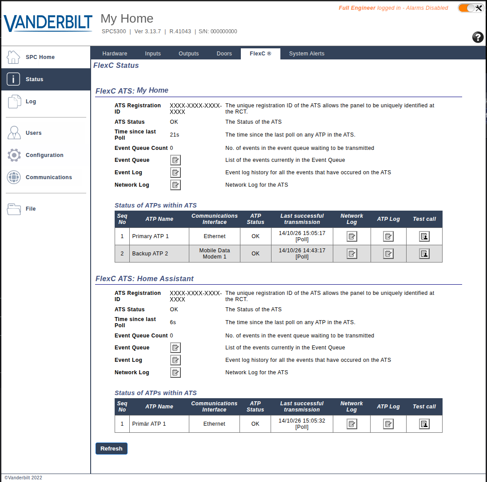

# Setting up the alarm panel

> Based on the panel setup guide by Henrik Ekblad in
> [henrikekblad/spc-flexc-home-assistant](https://github.com/henrikekblad/spc-flexc-home-assistant/blob/main/docs/panel-setup.md).
> The text and screenshots are MIT licensed, Copyright (c) 2026 Henrik Ekblad; see
> [images/LICENSE-panel-setup](images/LICENSE-panel-setup). The text is adapted to this
> integration. The screenshots are from his SPC5300 (firmware 3.13.7); the pages look the same
> on the SPC4300 this integration is tested on.

The panel connects to Home Assistant by itself over its FlexC protocol. You set up four things
in the panel's web interface:

1. the login Home Assistant uses (a FlexC command profile),
2. an event profile (which events are sent),
3. a receiver (a FlexC "ATS") pointing at Home Assistant,
4. the encryption key for the connection.

You need an engineer login to the panel's web interface. Do this on your local network.

> [!IMPORTANT]
> The panel does not send events while it is in engineer mode. Log out of engineer mode when
> you are done, before testing the integration.

## 1. Enter engineer mode

Log in to the panel's web interface with an engineer code and choose **Full Engineer** mode.


## 2. The login for Home Assistant

The integration asks for a **Command Profile username** and **password**. It sends every
command with them, and the panel's command profile decides which commands are allowed.

### Recommended: the command profile's own user

Go to **Communications → FlexC → Command Profile**. The built-in profile (normally **Default
Commands**) is read-only, so open it and click **Replicate**. In the copy:

- set **Authentication mode** to **Command User Only** (this is the setting the integration is
  tested with; on a French panel *Utilisateur Commandes seulement*);
- set your own **Command User Name** and **Command Password**; these go into the integration;
- tick the commands Home Assistant may send. For everything the integration offers (alarm,
  zones, doors, Mapping Gates, users, PIN codes, calendars, logs) tick all of them. For a
  read-only setup, tick only the `GET_`, `STATUS_` and `READ_` commands. A command that is not
  ticked answers `65` and the integration leaves that function out.

You select this profile as the receiver's **Command Profile** in step 4.

### Alternative: a panel user

With **Command User or Panel User**, a normal panel user can log in as well. Add a user, for
example `homeassistant`, with the **Manager** user profile:



The integration then logs in with the user's **web password**, not the PIN. A new user has no
web password yet. To set one, log in to the web interface as that user with its PIN, then go to
**Configuration → Change Own PIN → Change Web Password**.



### Names and passwords

- The panel's username field takes at most 16 characters.
- If you can log in to the web interface but Home Assistant reports **54: Authentication
  failed**, try a simpler password with only letters and digits. On firmware 3.14.1 a longer
  password was reported to work in the web interface but fail over FlexC.

## 3. Add an event profile

Go to **Communications → FlexC → Event Profiles** and click **Add**.

- Name it, for example `Home Assistant`.
- Tick the report box for every event type. You can narrow this down later.



The screenshot is from a panel where a few groups are still off (Network, Engineer accessing
system, Inhibits and Isolates, Zone Walk Test, Camera, Door Warnings). Turn them on as well; in
particular **Inhibits and Isolates**, so that Home Assistant sees a zone being inhibited or
isolated straight away instead of at the next poll, and **Door Warnings** and **Door
Information** for the door entities.

## 4. Add a receiver for Home Assistant

Go to **Communications → FlexC → FlexC ATS** and choose **Add Custom ATS**. Change these settings:

| Setting | Value |
|---|---|
| ATS Name | `Home Assistant` |
| Event Profile | the profile from step 3 |
| Command Profile | the profile from step 2 |
| ATS Polling Timeout | 20 seconds |
| Generate FTC | off |
| Re-queue Events | off |



Then choose **Add ATP to FlexC RCT** and set:

| Setting | Value |
|---|---|
| SPT Account Code | a number other than `0`, for example `999` |
| RCT URL or IP Address | the IP address of your Home Assistant |
| ATP Category | Cat 6 (Ethernet) |
| RCT TCP port | `52000`, or the port you choose in the integration |
| RCT ID | a number, for example `1` |

The integration does not ask for the account code or the RCT ID. With account code `0` the
integration assigns one, but a fixed number is the simplest. An ATS created with **Import ATS**
gets account code `0`.



Save, and the new receiver shows up in the list next to any receivers the panel already has:



Give Home Assistant its own ATS, rather than adding an extra ATP to an existing one. The ATPs
inside one ATS are backup paths to the same receiver.

## 5. Set the encryption key

Open **Advanced ATP Settings** and set:

| Setting | Value |
|---|---|
| Encryption Key Mode | Fixed Encryption |
| Encryption key | 64 hexadecimal characters (0–9, a–f) of your own choosing |

The integration needs the same key.



Make a random key on your own computer rather than on a website, for example:

```sh
# Linux, macOS
openssl rand -hex 32
# or, with Python
python3 -c "import secrets; print(secrets.token_hex(32))"
```

```powershell
# Windows (PowerShell 7)
[Convert]::ToHexString([Security.Cryptography.RandomNumberGenerator]::GetBytes(32)).ToLower()
```

Each prints 64 hexadecimal characters (32 random bytes). Keep the key somewhere safe: anyone who
has it can read the connection between the panel and Home Assistant.

## 6. Leave engineer mode and add the integration

Save and log out of engineer mode. Then add **SPC FlexC** in Home Assistant under **Settings →
Devices & services** with the panel's address, the TCP port, the key from step 5 and the login
from step 2 (see [Home Assistant configuration](../README.md#home-assistant-configuration)).

Once the integration is set up, the receiver's status in the panel shows that it is connected,
and the integration's *FlexC connection* sensor is on.



Which panels and firmware versions are tested: [Tested on](../README.md#tested-on).
